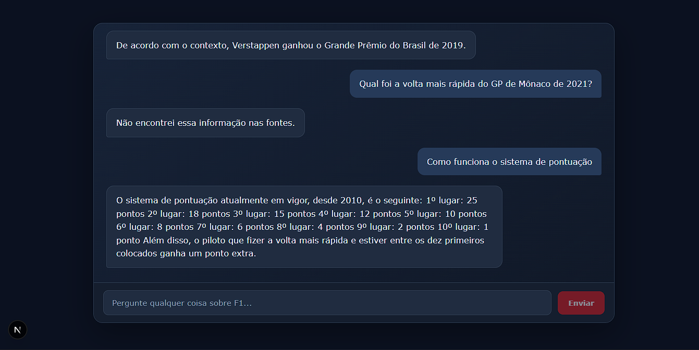

# F1 RAG

Chatbot sobre Fórmula 1 com RAG: coleta o texto de sites, guarda os embeddings no Qdrant e responde com um modelo rodando localmente no Ollama.

Projeto inspirado em um tutorial do freeCodeCamp, adaptado para usar tecnologias gratuitas e locais, como o Ollama (modelos de linguagem e embeddings) e o Qdrant (banco vetorial), sem depender de APIs pagas.

**Stack:** Next.js, AI SDK, LangChain, Qdrant, Ollama, Puppeteer.

## Como funciona

1. `npm run seed` abre cada página da lista `f1Data` com o Puppeteer, extrai o texto, divide em chunks e gera os embeddings com o `bge-m3`. Os vetores vão para o Qdrant.
2. No chat, a pergunta vira um embedding e o Qdrant devolve os trechos mais parecidos. Perguntas curtas de seguimento ("E da McLaren?") são reescritas com o histórico antes da busca.
3. Os trechos entram no prompt, e o `qwen2.5:7b` responde só com o que está neles. Se a informação não estiver nas fontes, o bot diz que não encontrou.

## Como rodar

1. Copie o `.env.example` para `.env`.
2. `docker compose up -d` sobe o Qdrant e o Ollama e baixa os modelos (a primeira vez demora).
3. `npm install`
4. `npm run seed` coleta os sites e grava no Qdrant.
5. `npm run dev` e abra http://localhost:3000

## Limitações

- O bot é tão atual quanto as páginas coletadas. Por exemplo, se uma fonte ainda trouxer uma regra antiga, a resposta repete a regra antiga. Para atualizar, rode o seed de novo.
- O Ollama do Docker usa só CPU, então as respostas podem levar de dezenas de segundos a alguns minutos. Um modelo menor (ex.: `qwen2.5:3b`) ou uma GPU acelera.

## Observações

- Se o Ollama do Windows estiver aberto, feche-o antes: a porta 11434 fica ocupada.
- Se trocar o modelo de embedding, apague a coleção `f1_documents` antes de rodar o seed.
- As fontes ficam na lista `f1Data` em `scripts/loadDb.ts`.